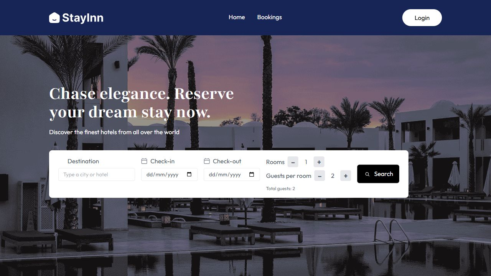
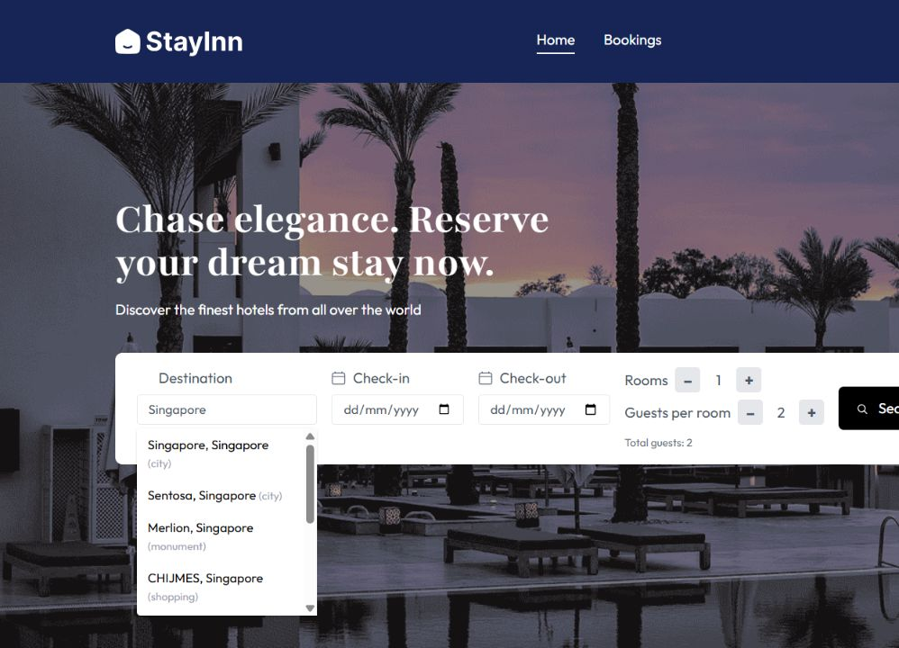
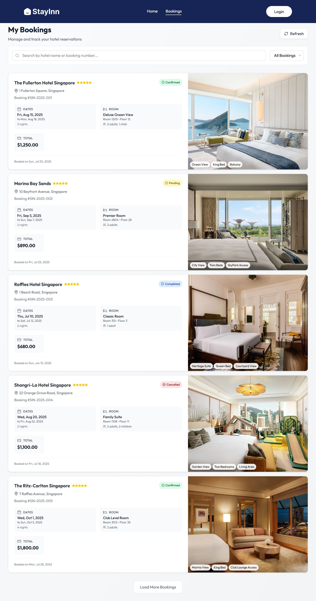
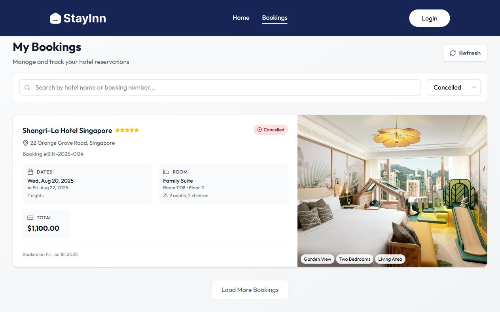
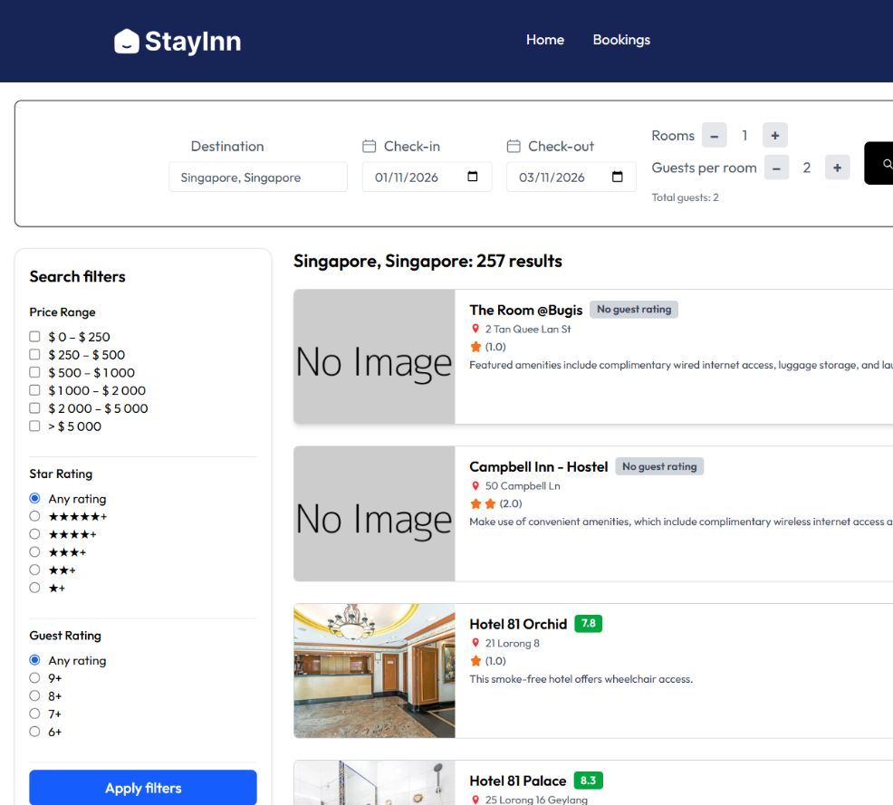
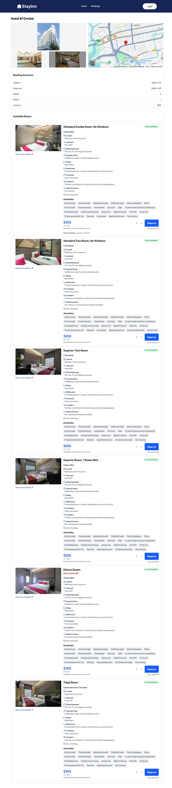
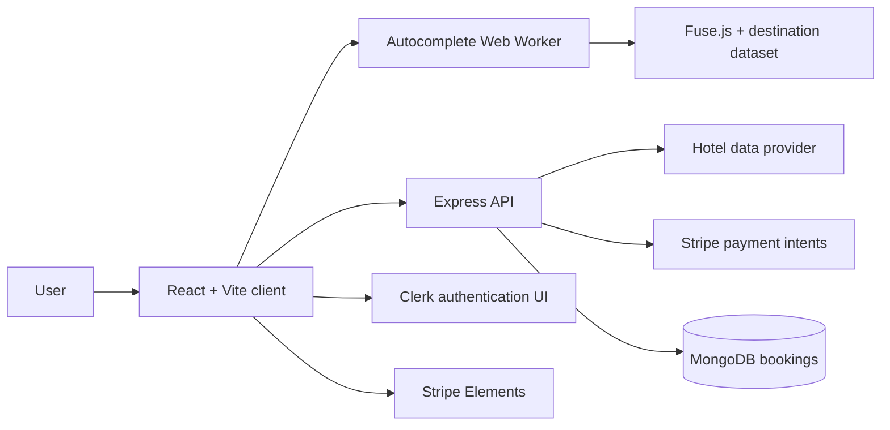

# StayInn

StayInn is a full-stack hotel-booking prototype built for SUTD's Elements of Software Construction module. It combines destination discovery, hotel and room browsing, a booking form, payment-intent creation, and a reservation dashboard in one responsive web application.

> The hotel catalogue was supplied through Ascenda APIs during the project. Public access may no longer be available, so live hotel searches depend on having access to a compatible upstream API. The screenshots below show the working local interface; the bookings dashboard currently uses representative demo records.

## Screenshots

### Hotel search



### Fuzzy destination autocomplete



### Booking management



### Status filtering



### Live Singapore hotel results



### Live room inventory

The room details view presents every available room type with its photos, bed configuration, amenities, cancellation terms, remaining inventory, nightly price, market-rate comparison, and reservation controls. Availability and prices shown here were returned by the live hotel API for the selected dates and may change.



### Hotel gallery


## What the project demonstrates

- A modular React interface organised into pages, reusable feature components, and shared UI primitives.
- Fast fuzzy destination matching with Fuse.js in a Web Worker, keeping the main UI thread responsive while searching a large destination dataset.
- A clear client/server boundary: the Express service proxies hotel data, creates Stripe payment intents, and stores booking records in MongoDB.
- Authentication UI integration through Clerk and payment UI integration through Stripe Elements.
- Hotel filtering, sorting, lazy loading, room selection, guest and billing validation, booking totals, and reservation status filtering.
- Layered verification with Vitest and Testing Library, Cypress end-to-end scenarios, and dedicated API/form fuzzing tools.

## Architecture



The frontend uses React Router to separate hotel search, room details, checkout, confirmation, and booking-management flows. Business logic is split into feature components and utilities instead of being concentrated in a single page. The backend acts as an integration layer so provider credentials and database access remain outside the browser.

## Technology

- **Frontend:** React 19, Vite, Tailwind CSS, React Router, Fuse.js, Clerk, Stripe Elements
- **Backend:** Node.js, Express, MongoDB, Stripe, Axios
- **Testing:** Vitest, Testing Library, Supertest, Cypress, custom fuzzers

## Local setup

Requirements: Node.js 20 or newer, npm, and a MongoDB instance or Atlas connection.

1. Configure the frontend:

   ```bash
   cd client
   copy .env.example .env
   npm install
   npm run dev
   ```

2. In a second terminal, configure and start the backend:

   ```bash
   cd server
   copy .env.example .env
   npm install
   npm run dev
   ```

3. Replace the placeholder values in both `.env` files with your own development credentials. Environment files are ignored by Git and should never be committed.

The client runs at `http://localhost:5173` and the API defaults to `http://localhost:8080`.

## Verification

Run the frontend build and automated unit/integration suite:

```bash
cd client
npm run build
npm test -- --run
```

The current suite contains **107 passing tests** across frontend components, integration flows, server endpoints, error handling, and edge cases.

For full browser scenarios, install the root dependencies, start both services, and run:

```bash
npm install
npm run e2e
```

See [cypress/README.md](cypress/README.md) for the end-to-end coverage and [fuzzing/README.md](fuzzing/README.md) for robustness testing. Only run the fuzzers against systems you own or are explicitly authorised to test.

## Project context and credits

StayInn was developed as a group project. Credit goes to:

- [c-xinghan](https://github.com/c-xinghan)
- [strikeknight02](https://github.com/strikeknight02)
- [spicyonflower](https://github.com/aaj1510)
- [Kridw4n](https://github.com/Kridw4n)
- [Eddyswj](https://github.com/Eddyswj)
- [furrbeebs](https://github.com/furrbeebs)
- [Leix2](https://github.com/Leix2)

An earlier project video is available [here](https://github.com/user-attachments/assets/26b7a7ea-df04-44ae-8c38-c17f683e00eb).
